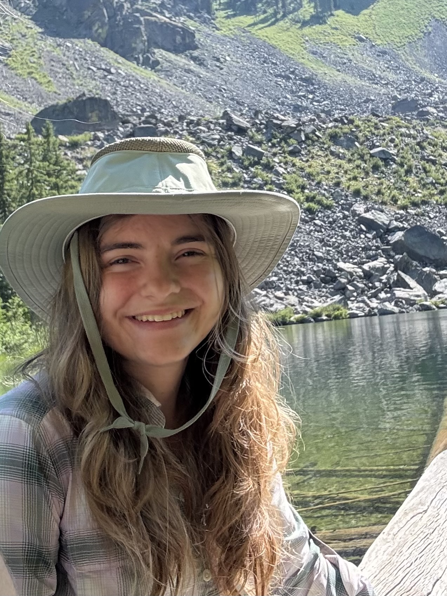
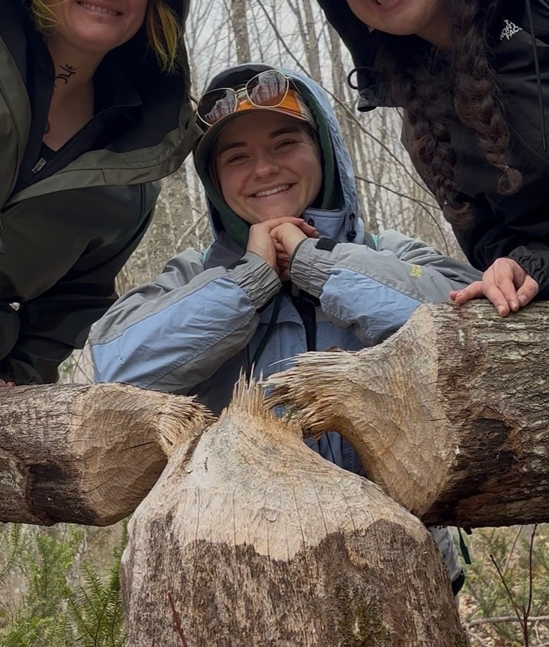

---
hide:
  - toc
  - navigation
---
<!--
CHECKLIST FOR THIS PAGE:
- [ ] Replace [YOUR NAME] with your full name (3 places)
- [ ] Replace [YOUR JOB TITLE] with your current or target role
- [ ] Replace [YOUR TAGLINE] with a short phrase describing your focus
- [ ] Rewrite the About Me paragraph with your own words
- [ ] Replace assets/images/profile.png with your actual photo (keep the filename or update it below)
- [ ] Replace assets/images/about.png with your own image (a field photo, map, or workspace shot)
- [ ] Edit the skill cards to match your actual skills (add, remove, or rename cards as needed)
- [ ] Update GitHub and LinkedIn links in the Connect section
- [ ] Add your CV PDF to docs/assets/ and update the filename in the Download CV button
-->

  
  <h1>Caitlin McWilliams</h1>
  
<strong>Research Assistant</strong>

  
<em>Using GIS to aid land stewardship</em>

---

## About Me

I am a masters of GIS student with a background in land management, remote sensing, and machine learning.
Under the Fairfax Beaver Lab, I'm working with the Great Lakes Fish and Wildlife Commission to make historical maps of wild rice using remote sensing, machine learning, and GeoAI. I am passionate about applying remote sensing to help land stewardship projects.

  

---

[View My Projects :material-arrow-right:](projects/index.md){ .md-button .md-button--primary }
[Download CV :material-download:](assets/Caitlin-CV.pdf){ .md-button }

---

## Skills

-   **GIS & Remote Sensing**

    ---

    - Google Earth Engine, ArcGIS Pro/Online, QGIS

-   **Programming**

    ---

    - Python, R, Java

-   **Machine Learning & GeoAI**

    ---

    - Supervised classification: Random Forest
    - Deep learning for image segmentation: U-Net

-   **Drone Processing**

    - Mission planning and flight operations
    - Point cloud processing: Pix4D

---

## Connect

[GitHub](https://github.com/;efsey){ .md-button }
[LinkedIn](https://linkedin.com/in/caitlin-mcwilliams-5a1851229){ .md-button }
