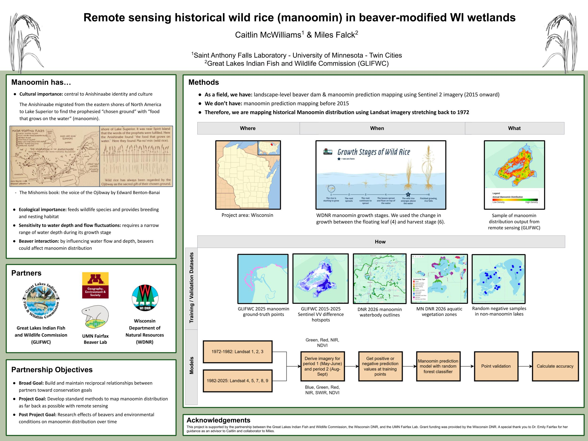

---
hide:
  - toc
  - navigation
---

## Conference Posters & Presentations

1. Caitlin McWilliams and Miles Falck (2026). "Remote sensing historical wild rice (manoomin) in Wisconsin wetlands." *GIS/LIS Conference*

2. Caitlin McWilliams and Miles Falck (2026). "Remote sensing historical wild rice (manoomin) in beaver-modified WI wetlands." *BeaverCON*

## Thesis

1. Caitlin McWilliams (2025). *Beaver Management Conflicts on the North Shore*. Environmental Studies thesis. Carleton College.

---
