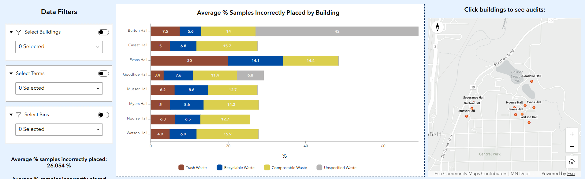
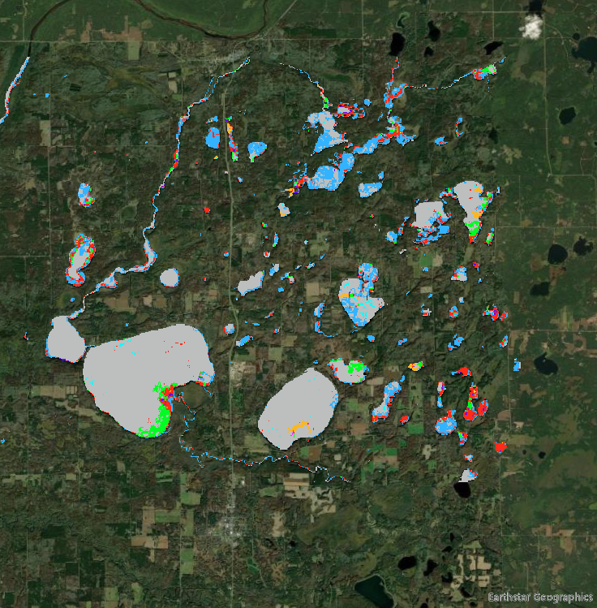
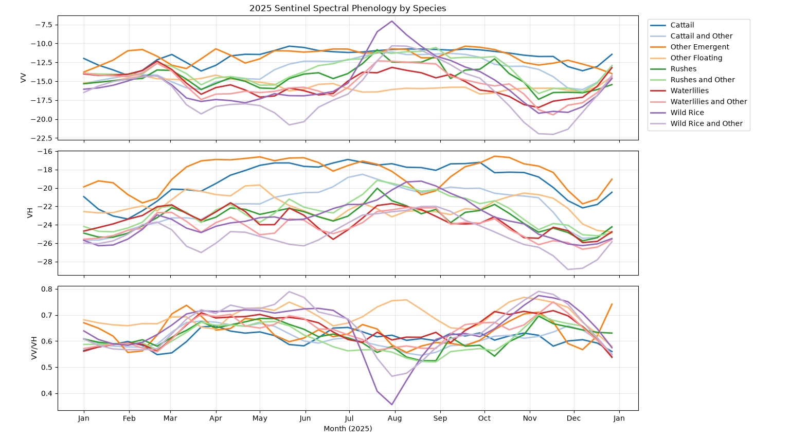
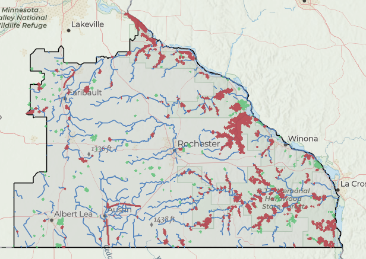

---
hide:
  - toc
  - navigation
---

# Projects

**Waste Audit Dashboard**

To aid the Carleton College custodial staff, I developed a dashboard and field maps app to help monitor incorrectly-sorted recycling and compost items in college buildings. The audits are still ongoing and the dashboard is reporting live, publicly-available results on Carleton's website.

[View Project →](https://experience.arcgis.com/experience/a8e20114c25148c7a2ce98baf4f0e718){ .md-button target="_blank"}

**Wild Rice Stand Change Detection**

To determine how wild rice distribution has changed over time, I used the DynamicPATCH package in VS Code to create rasters showing wild rice transition patterns from 2015-2020 and 2020-2025.

[View Map Image →](../assets/images/timeseries.png){ .md-button target="_blank"}

**Aquatic Plant Spectral Phenology**

To determine the difference between the aquatic plant stands mapped by the DNR in 2025, I mapped their spectral phenology.

[View Map Image →](../assets/images/aquatic-plant-spec-phenology.png){ .md-button target="_blank"}

**DNR Management Units with Impaired Streams**

As part of an intermediate data science class project, I determined which DNR management units intersected with DNR-rated impaired streams.

[View Project →](https://arcg.is/OKbjX0){ .md-button target="_blank"}

